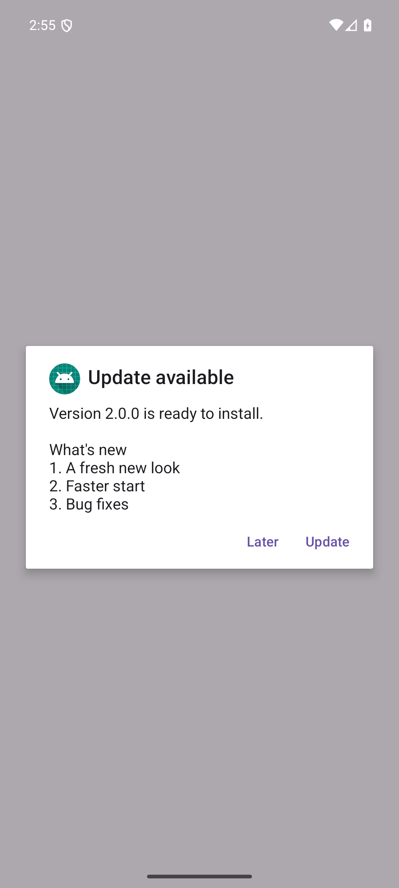
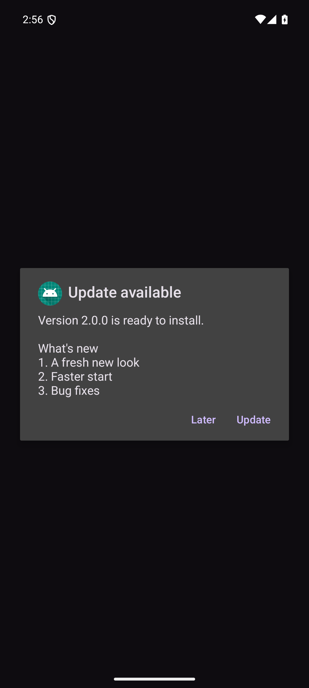

# AndroidAppUpdater

A small update checker for Android apps. You host one JSON file anywhere (GitHub, your server, S3). The library reads it, compares the version with the installed app, and can show a ready-made update dialog, or just hand you the data.

1. **You host the JSON:** no Play Services, no update SDK.
2. **Built-in dialog:** shows the new version and what's new, and follows your app's theme in light and dark mode.
3. **Forced updates:** set `"cancellable": false` and the dialog has no "Later" button.
4. **Or build your own UI:** get the parsed data and the whole JSON in a callback.
5. **Tiny:** a few small classes, written in Kotlin, works from Java too. Min SDK 21.

## Screenshots

| Light | Dark |
|---|---|
|  |  |

## Install

1. Add JitPack in `settings.gradle.kts`:

```kotlin
dependencyResolutionManagement {
    repositories {
        google()
        mavenCentral()
        maven("https://jitpack.io")
    }
}
```

2. Add the dependency:

```kotlin
dependencies {
    implementation("com.github.p32929:AndroidAppUpdater:2.0.0")
}
```

## The JSON file

```json
{
  "versionCode": 2,
  "cancellable": true,
  "url": "https://play.google.com/store/apps/details?id=your.app",
  "versionName": "2.0.0",
  "changelog": "1. A fresh new look\n2. Bug fixes"
}
```

1. `versionCode` (required): the version code of the newest release.
2. `cancellable` (required): `false` forces the user to update.
3. `url` (required): where the Update button takes the user, like Google Play or a download page.
4. `versionName` and `changelog` (optional): shown in the built-in dialog.
5. Any other fields you add are passed to you in the callback.

There is a working example in [docs/sample-update.json](docs/sample-update.json).

## Usage

### The easy way

Call this in your activity, for example in `onCreate`. It shows the dialog only when a newer version is out.

Kotlin:

```kotlin
AppUpdater.check(this, "https://example.com/update.json")
```

Java:

```java
AppUpdater.check(this, "https://example.com/update.json");
```

The activity must use an AppCompat or Material theme. With a Material 3 theme the dialog looks like Material 3.

### Your own UI

Kotlin:

```kotlin
AppUpdater(this, jsonUrl, object : UpdateListener {
    override fun onJsonDataReceived(updateModel: UpdateModel, jsonObject: JSONObject) {
        if (updateModel.isNewerThanInstalled(this@MainActivity)) {
            // Show your own UI, or the built-in one:
            AppUpdater.showDialog(this@MainActivity, updateModel)
        }
    }

    override fun onError(error: String) {
        // No internet, bad URL or bad JSON
    }
}).execute()
```

Java:

```java
new AppUpdater(this, jsonUrl, new UpdateListener() {
    @Override
    public void onJsonDataReceived(UpdateModel updateModel, JSONObject jsonObject) {
        if (updateModel.isNewerThanInstalled(MainActivity.this)) {
            AppUpdater.showDialog(MainActivity.this, updateModel);
        }
    }

    @Override
    public void onError(String error) {
    }
}).execute();
```

Callbacks run on the main thread. They are skipped if the activity is already closing.

## Migrating from 1.x

Most code keeps working. `new AppUpdater(context, url, listener).execute()`, `UpdateListener`, `UpdateModel.getVersionCode()`, `isCancellable()`, `getUrl()` and `AppUpdater.getCurrentVersionCode(context)` are all the same.

1. Change the dependency to `com.github.p32929:AndroidAppUpdater:2.0.0` and use the JitPack line above.
2. `AppUpdater` is no longer an `AsyncTask`, so `cancel()` and `executeOnExecutor()` are gone. Just call `execute()`.
3. The library no longer checks the network first, so the "Please check your network connection" error is gone. Network problems now come to `onError` with the real reason.
4. The `ACCESS_NETWORK_STATE` permission is no longer added to your app.
5. Your old JSON files work as they are.

## License

MIT License — Copyright (c) 2019 Fayaz Bin Salam. See [LICENSE](LICENSE) for the full text.

## Contributing

Contributions are very welcome, thank you! Before you start on a pull request, please open an issue and tell me what you would like to add or change. That way we can agree on it first, and your time is not wasted on something that might not fit. Thanks for helping make AndroidAppUpdater better.

## You might also like

<p><a href="https://openstore.pfay.workers.dev/cards/p32929/0?n=4&amp;repo=AndroidAppUpdater"><picture><source media="(prefers-color-scheme: dark)" srcset="https://openstore.pfay.workers.dev/cards/p32929/0.svg?n=4&amp;repo=AndroidAppUpdater&amp;theme=dark"></picture></a><a href="https://openstore.pfay.workers.dev/cards/p32929/1?n=4&amp;repo=AndroidAppUpdater"><picture><source media="(prefers-color-scheme: dark)" srcset="https://openstore.pfay.workers.dev/cards/p32929/1.svg?n=4&amp;repo=AndroidAppUpdater&amp;theme=dark"></picture></a><br><a href="https://openstore.pfay.workers.dev/cards/p32929/2?n=4&amp;repo=AndroidAppUpdater"><picture><source media="(prefers-color-scheme: dark)" srcset="https://openstore.pfay.workers.dev/cards/p32929/2.svg?n=4&amp;repo=AndroidAppUpdater&amp;theme=dark"></picture></a><a href="https://openstore.pfay.workers.dev/cards/p32929/3?n=4&amp;repo=AndroidAppUpdater"><picture><source media="(prefers-color-scheme: dark)" srcset="https://openstore.pfay.workers.dev/cards/p32929/3.svg?n=4&amp;repo=AndroidAppUpdater&amp;theme=dark"></picture></a></p>

<p><a href="https://p32929.github.io/share/?repo=AndroidAppUpdater"><picture><source media="(prefers-color-scheme: dark)" srcset="https://p32929.github.io/readme/footer-share-dark.svg"></picture></a><a href="https://p32929.github.io/support/"><picture><source media="(prefers-color-scheme: dark)" srcset="https://p32929.github.io/readme/footer-support-dark.svg"></picture></a><br><a href="https://openstore.pfay.workers.dev/add"><picture><source media="(prefers-color-scheme: dark)" srcset="https://p32929.github.io/readme/footer-join-dark.svg"></picture></a></p>
